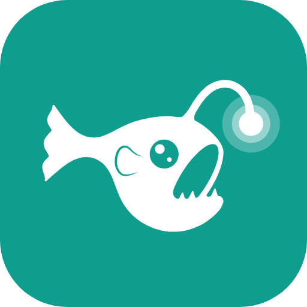
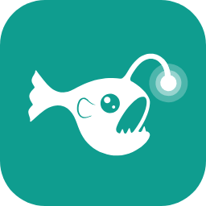

<p align="center"></p>

<h1 align="center">lampfish</h1>

<p align="center">Customize and monitor your Windows PC from a single app.</p>

<p align="center">
  <a href="#services">Services</a> ·
  <a href="#install">Install</a> ·
  <a href="#build-from-source">Build</a> ·
  <a href="CHANGELOG.md">Changelog</a>
</p>

lampfish lives in the system tray and brings together wallpapers, icons, cursors, sounds, desktop layout, the health of the PC, disk usage, network, hardware and running programs. It needs no administrator rights, no account and no server, and it collects no data: everything stays on the PC. Settings lists the few outside services it calls (weather, connection test, update check) and when. An assistant, if you turn it on, sits as a round button wherever you put it on the screen: a click opens a small window to write a note, take a capture (also Ctrl Alt S) or glance at the PC, and Ctrl Alt N writes a note from any app. In Plugins, Claude usage shows how much of a Claude plan is used, read with the sign-in of Claude Code on the PC; it is off until you turn it on. On the very first start, a short welcome shows what it does and asks four questions, all of them skippable.

## Services

| Service | What it does |
| --- | --- |
| **Home** | The time and today's weather, your current wallpaper with your real desktop icons on it (previous, pause, next, themes in one click), this PC at a glance (processor, memory, disk, battery, network), quick settings (warm screen, energy saver, screen and sleep delays) and cards of the other services. Customize picks the cards, their order and the blocks shown. |
| **Themes** | Each theme shows its own wallpaper, dimmed as on the desktop, with its icon, cursors, sounds and triggers, and can warm the screen. Puts back a wallpaper, cursors, sounds and the audio output in one click, or by itself: at a set time, with a set number of screens, on mains power or battery, when an app opens or when headphones are plugged in (the previous setup comes back when the app closes or the headphones are removed). A theme can also open apps or files, and can be exported and imported. |
| **Wallpaper** | Animated wallpapers behind the desktop icons, one for every screen or one per screen: videos, GIFs, animated images, HTML pages, optionally pulsing with the sound playing, with fades, a slideshow that can shuffle and a frame rate choice. Pauses on battery, when a window covers the screen or while the session is locked. |
| **Create** | Builds a wallpaper from your logo and background: themes, particles, glow, a sound reaction and a live preview with snap guides where the logo and the text are placed, typed and resized. Made wallpapers can be edited again. |
| **Display** | A map of your screens to choose the main one, dark mode, a warm screen for the evening, a link to the Night light of Windows, when the screen turns off and the PC sleeps (plugged in and on battery) and the energy saver on battery. |
| **Audio** | Every speaker, headset, screen and microphone of the PC as a tile with its format, live level, volume and mute. A click makes one the default for every app, and an optional shortcut switches to the next output from any app. |
| **Taskbar** | The settings Windows keeps for the taskbar in one page: alignment, the search, Task View, Widgets, the show desktop corner, seconds in the clock, combining windows, the taskbar on every screen and its automatic hiding, each change with Undo. The position, size and transparency are left alone: Windows has no setting for them. |
| **Icons** | Gives any folder an icon from the Windows library (sorted retro pixel / modern) or your own, from the app or the right-click menu, with a way back to the icon it had before. |
| **Mouse** | Cursor themes (including original pixel-art themes and a smooth, lightly animated one) sorted by family, any single cursor for a role, per-role cursors saved as your own themes, pointer size, speed, double-click, wheel and extras, with a way back to the mouse you had before. |
| **Sounds** | A sound for thirteen system events (startup, lock, sleep, charger, USB devices, docking station, speed test), with a sound library, loudness matching and import. |
| **Arrange** | A live map of your screens (one, two, three or more) to sort and lay out desktop icons in eight even arrangements, five icon sizes, undo, a way back to the original layout, your own saved arrangements, and layouts saved per screen setup. |
| **Notes** | Notes written in Markdown, with a bar for titles, lists, tasks and links, and a reading view. They save themselves as they are written, as plain .md files in lampfish's folder or in a folder of an Obsidian vault. |
| **Shelf** | A place to keep files and captures at hand: drop files to keep a copy, take a capture of a zone, a window or a screen, draw on it (pen, arrows, frames, numbered steps, text, pixelate, crop), copy it, or drag it into another app. |
| **Convert** | Changes the kind of a file on this PC, with nothing sent anywhere: images into PNG, JPG, BMP, GIF, TIFF, an icon or a PDF, a PDF into images, merged, cut or turned, text and Office documents into a PDF. The results go to the Shelf and the originals are never touched. |
| **Health** | Why the PC is slow, in plain words with the button that helps, a security check (antivirus, firewall, updates, encryption), the privacy switches of Windows and the programs that start with Windows, each with a switch. |
| **Storage** | What takes up space on a drive, as rings (in the spirit of DaisyDisk), without administrator rights, and whether File Explorer shows file extensions and hidden files. |
| **Duplicates** | Files stored twice, compared byte for byte, with the copies that are safe to clean ticked, a summary before anything goes to the Recycle Bin, and Restore. |
| **Network** | Connection details, live traffic, a security check of the connection, and a speed test with jitter, loaded latency (graded A to F) and history. |
| **Tasks** | What is running, grouped by program with its icon, publisher, memory and processor use, sorted into apps, command-line, background and system programs, with a search and a sheet per program (version, location, start with Windows, open connections). Ends a program on request, and a Memory card shows what closing the programs not in use would free, then closes what you tick. |
| **Hardware** | Processor, memory, graphics, storage, battery, screens, temperature and connected devices, read live, with a plain-language health summary and a summary to copy. |

The interface is in English, with a French translation (automatic, following the Windows language, or chosen in Settings). The bar opens each family in a flyout, a Go to search (Ctrl K) opens any service by name, and the cards of Home can be dropped in any cell of a grid. The bar can be arranged from its foot: services move inside their family, families move, and a service can be hidden. Ctrl 1 to 9 open the services in the order of the bar, Ctrl Tab the next one, Ctrl comma the settings, and the tray menu skips to the next wallpaper, pauses it or applies a theme. `Lampfish.exe --quit` closes a running lampfish.

## Requirements

- Windows 10 or 11 (64-bit)
- [Microsoft Edge WebView2 Runtime](https://developer.microsoft.com/microsoft-edge/webview2/) (already installed on Windows 11)
- .NET Framework 4.8 (included in Windows 10 and 11)

## Install



Download `Lampfish-Setup-<version>.exe` from the [latest release](../../releases/latest) and run it. It installs lampfish for your account only, without administrator rights, in `%LOCALAPPDATA%\Programs\Lampfish`.
The installer is not signed yet: Windows SmartScreen may ask for confirmation the first time ("More info", then "Run anyway").

New versions install from Settings > Updates, keeping your settings. To uninstall, use Settings > Apps > Installed apps in Windows: lampfish first puts back the cursors, folder icons and right-click menu it changed, then asks whether to keep your settings and files.

## Build from source

```powershell
powershell -ExecutionPolicy Bypass -File src\build.ps1
```

The script uses the C# compiler that ships with Windows (no Visual Studio needed). On first run it downloads the official WebView2 SDK from NuGet into `app\lib\`.

`src\publish.ps1` builds the installer into `dist\` with [Inno Setup 6](https://jrsoftware.org/isinfo.php) (`winget install JRSoftware.InnoSetup`), from `src\installer.iss`. GitHub Actions runs the same script on every push and tag. Other generators, in Python 3: `src\icon.py` (app icon), `src\app_icon.py` (icon variants), `src\cursors.py` and `src\cursors_modern.py` (cursor themes), `src\sounds.py` (sound packs), `src\wallpapers.py` (the logo wallpapers).

## Project layout

```
Lampfish.exe         built by src\build.ps1
app\ui\              the settings window (HTML, CSS, JavaScript), translations in locales\
app\player\          the page that plays a wallpaper
app\templates\       the page behind wallpapers made in Create
app\cursor-themes\   lampfish cursor themes
app\sounds\          the notes of the connection test
wallpapers\          wallpapers
sounds\              sound packs
src\                 C# code, build scripts and generators
brand\               logo and badge
```

## Versioning

lampfish follows [Semantic Versioning](https://semver.org/): `MAJOR.MINOR.PATCH`. While the version starts with `0.`, anything may still change. Each release is a Git tag (`v0.1.0`) with a GitHub release, and every change is listed in [CHANGELOG.md](CHANGELOG.md).

## License

[MIT](LICENSE)

lampfish ships the [WebView2 SDK](https://www.nuget.org/packages/Microsoft.Web.WebView2) of Microsoft (BSD 3-Clause), whose license and notices are installed next to its DLLs in `app\lib\`. Everything else is part of this project: the sound packs and cursor themes come from the generators in `src\`.

<p align="center"></p>
